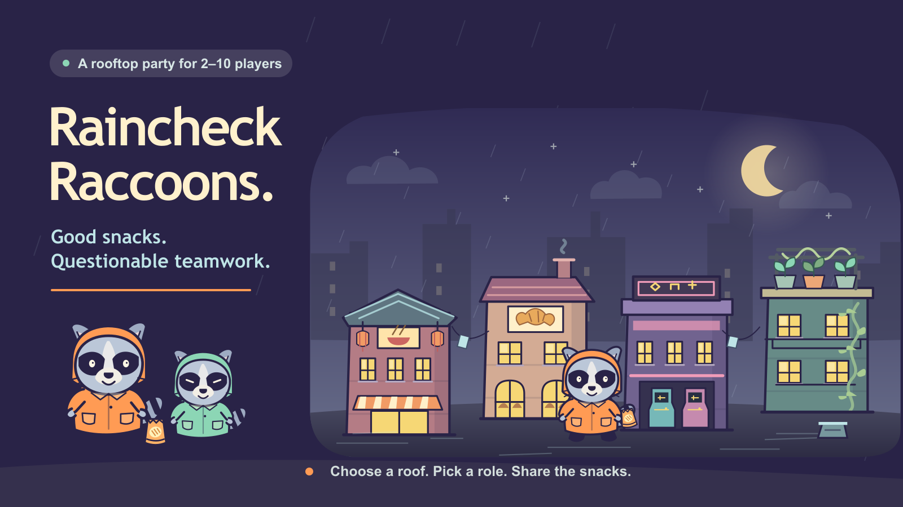
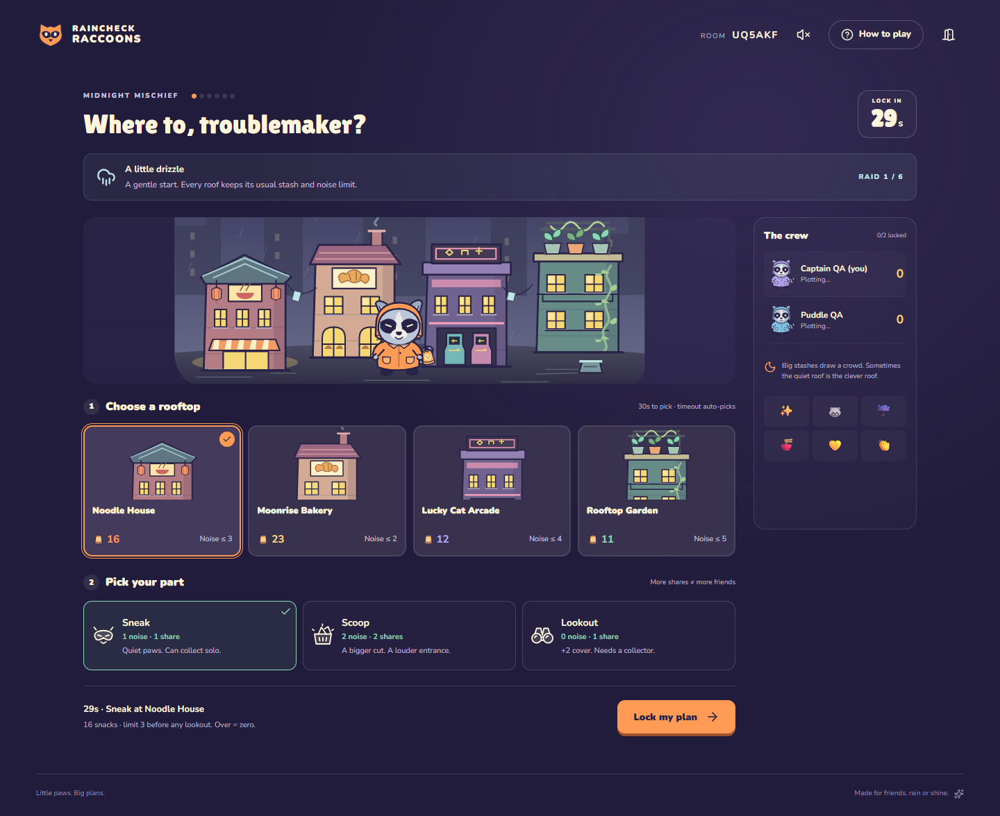
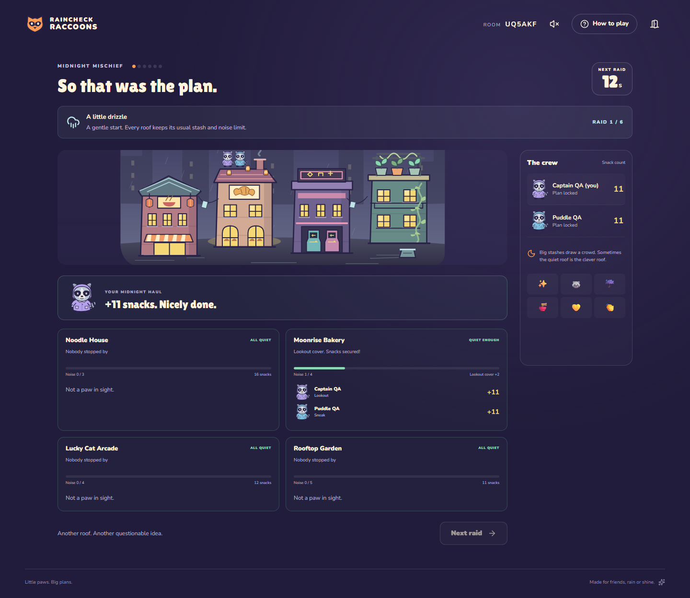
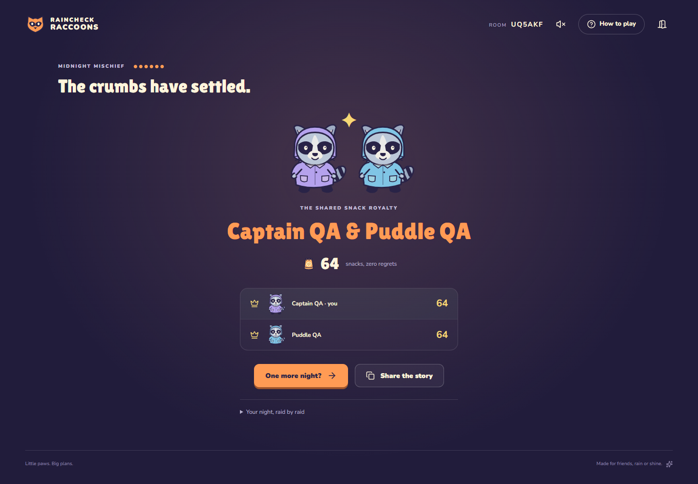
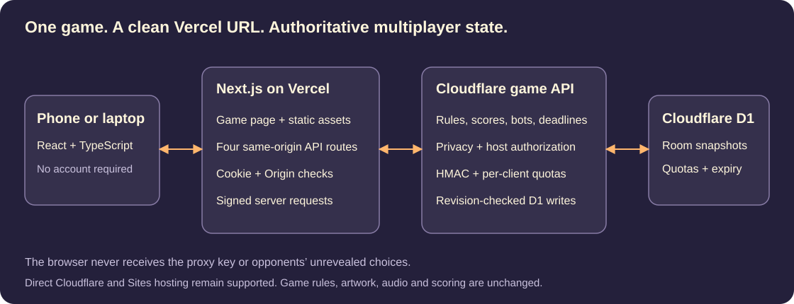
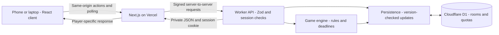

# Raincheck Raccoons

**Little paws. Big plans. A rooftop snack heist for 2–10 friends.**



**[Play live →](https://raincheck-raccoons.vercel.app)** · [Original Sites deployment](https://raincheck-raccoons.smoky-harp-3438.chatgpt.site) · [Run locally](#run-locally) · [Architecture](docs/architecture.md) · [Verification](docs/testing.md)

[](https://github.com/rmaytr/Raincheck-Raccoons/actions/workflows/ci.yml)


The city is asleep. Your snack heist is just getting started. Secretly pick a rooftop and a role, then discover who had the same idea. Stay under the noise limit and split the snacks; wake the neighbors and everyone on that roof leaves empty-pawed. After six raids, the biggest stash wins.

Create a room and send its six-character code or invitation link. Guests play in their own phone or laptop browsers: no account, download, microphone, or separate host display required. **Arriving alone? Choose “Try a practice night” to play the real rules with three labeled bots.**

## See the game


*Every player makes two private choices. Public forecasts and different roof capacities make the crowd worth predicting.*


*The reveal explains the consequence of everyone's choices. Readiness is public during planning; the choices themselves are not.*


*Six raids end in a recap and final standings. Ties share the crown, and the same crew can rematch.*

These are actual browser-test captures, with test nicknames. The cover and in-game illustrations were created for this project.

## How it works

| Role | Noise | Shares | Tradeoff |
|---|---:|---:|---|
| Sneak | 1 | 1 | Quiet collector; can collect alone |
| Scoop | 2 | 2 | Bigger cut in a crowd; more noise |
| Lookout | 0 | 1 | Adds 2 cover and cancels weather penalties; needs a collector |

The four roofs have different stashes and noise limits. A safe crew divides a finite stash by shares, rounded down. Equal noise and capacity is safe; exceeding capacity earns everyone zero. Lookout protection applies once per roof, and an all-lookout crew collects nothing. No one is eliminated.

- **Simultaneous play:** 30-second planning windows; results reveal together. Missing submissions receive disclosed conservative auto-picks.
- **Private invitation rooms:** 2–10 active humans/bots, host controls, eight raincoat avatars and six predefined reactions. Four or more players create stronger crowd prediction; two-player games are supported.
- **Repeat play:** six authored forecasts, changing stashes, final history and rematches.
- **Recovery:** cookie-based seat restoration after refresh, reconnect notices, temporary-outage Retry and automatic host transfer after 55 seconds of inactivity as requests update the room. Rooms expire after 12 hours.
- **Original presentation:** scalable SVG city art, optional synthesized sound, locally hosted licensed fonts and responsive layouts.
- **Accessible interaction features:** keyboard focus, named controls, focus-managed dialogs, phase announcements and reduced-motion styling. See the [testing limits](docs/testing.md#limits).

## Technology and architecture

| Layer | Technology actually used |
|---|---|
| Interface and contracts | React 19.2.6, TypeScript 5.9.3 |
| Framework/build | Next.js 16.3.4 for Vercel; Vinext 1.0.0-beta.5 / Vite 8.0.13 for the Cloudflare backend |
| Styling/art/audio | Custom CSS, Tailwind CSS 4.2.1, SVG, Web Audio API, Lucide icons |
| Backend | Vercel Node.js route handlers, signed HTTP requests to Cloudflare Workers, Fetch API / JSON |
| Persistence | Cloudflare D1, parameterized SQL, revision-checked room snapshots |
| Schema/validation | Drizzle ORM/Kit for schema and migrations; Zod for runtime payload validation |
| Testing/tooling | Node test runner, Playwright, Wrangler, npm lockfile, GitHub Actions |



<details>
<summary>Editable Mermaid diagram</summary>



</details>

The server owns legality, scores and phase changes. Clients poll after approximately 900 ms during play, 1.4 seconds in the lobby and 4 seconds while hidden; these are request delays, not latency benchmarks. D1 compare-and-swap updates retry conflicting actions against the latest revision. Match/round identifiers reject stale submissions. Explicit public projections omit session hashes and opponents' unrevealed choices. [Read the architecture decisions →](docs/architecture.md)

```text
app/                  Screens, CSS, metadata and four room API routes
components/Art.tsx    Original city, mascots, roof and role illustrations
lib/engine.ts         Rules, scoring, bots, deadlines and phase progression
lib/server.ts         Authoritative Cloudflare API, identity and quotas
lib/server-vercel.ts  Same-origin Vercel gateway and session forwarding
lib/proxy-auth.ts     Short-lived HMAC authentication between deployments
lib/store.ts          D1 persistence and optimistic concurrency
lib/types.ts          Shared public models and action contracts
lib/audio.ts          Optional browser-synthesized sound
db/ + drizzle/        Typed schema and versioned SQL migration
scripts/              Build support, local migrations and verification runner
tests/                Engine, API and browser integration harnesses
docs/                 Focused design, setup, evidence and attribution
```

## Deploy to Vercel

The repository now builds native Next.js output (`.next`) with `npm run build`; `vercel.json` selects the correct preset. The frontend and four same-origin API routes run on Vercel. The existing game engine and D1 database remain on Cloudflare behind a signed server connection. Production and preview need the private `RAINCHECK_PROXY_SECRET` and the server-only `RAINCHECK_BACKEND_URL`; neither is exposed to the browser. See [Vercel setup and architecture](docs/vercel-deployment.md).

## Run locally

**Prerequisites:** Node.js **24 LTS** (see `.nvmrc`), npm, Git. No cloud account, production database or API key is required for local play. Keep Node within the project's supported runtime range.

```sh
git clone https://github.com/rmaytr/Raincheck-Raccoons.git
cd Raincheck-Raccoons
npm run install:ci
npm run build:cloudflare
npm run db:migrate
npm run dev:cloudflare
```

Open **http://localhost:5173**. Create a room or choose solo practice. The migration command only targets local D1 and is safe to rerun; it tracks applied migrations. Build before migrating because local storage configuration derives from the generated Worker config. Development and production-style local preview share `.wrangler/state`.

For a production-style local preview:

```sh
npm run start:cloudflare -- --port 4173
```

No `.env` is needed. The optional [`.env.example`](.env.example) documents test overrides; standalone test scripts read exported environment variables rather than loading that file. `.openai/hosting.json` contains a public hosting identifier and logical bindings, **not credentials**. Do not publish environment secrets or local database state.

### Verify a clean checkout

```sh
npm run typecheck
npm test
npm run test:proxy
npm run build
npm run build:cloudflare
npm run db:migrate
npx playwright install chromium
npm run verify:local
npm run verify:vercel
```

On Linux, use `npx playwright install --with-deps chromium` if browser system libraries are missing. The verification runner owns sequential temporary loopback previews on **4173**: API/lifecycle checks use the development Worker, and browser suites use the production build. It writes ignored `test-results/` artifacts and stops each server. Stop any existing server on 4173 first. Individual API/browser commands and Windows troubleshooting are documented in [development.md](docs/development.md).

The standalone Cloudflare deployment uses a separate D1 database. See [deployment instructions](docs/development.md#standalone-cloudflare-workers-deployment) to update the `workers.dev` release.

## Verification and engineering results

| Evidence | Scope |
|---|---|
| 27 engine tests | Includes 400 seeded scoring configurations and stale-match, tie, timeout and bot cases |
| 49 API integration checks | Independent sessions, six rounds/rematch, privacy, permissions, nine concurrent joins and ten concurrent choices |
| 3 real-time lifecycle checks | Actual planning timeout, autonomous bots and absent-host transfer |
| 24 browser journey checks | Real UI create/join, refresh, disconnect/recovery, full match, finale and rematch |
| 7 targeted browser checks | 320px layout, reduced motion, sound preference, transient startup failure and delayed response after leave |

**October 26, 2026 publication verification:** typecheck, production build, local migrations, all 27 engine tests and all 83 integration checks passed locally. The documentation checker validated 40 internal links/images. [Environment and methodology](docs/testing.md#publication-verification--october-26-2026) distinguish this run from CI.

Historical **October 24, 2026** public verification used independent Edge sessions on one computer, including desktop and mobile viewports. All 31 browser checks passed; the full journey took 51 seconds and targeted suite 5.7 seconds. These are automation run durations, not user-game lengths or response-time metrics. [Selected JSON evidence](docs/evidence/multiplayer-2026-10-24.json) and [test methodology](docs/testing.md) distinguish injected failures, simulations and browser emulation from human playtesting. The CI badge reports the actual workflow state; historical results do not establish a current CI pass.

## Project context and tradeoffs

Created for the Handshake × OpenAI multiplayer challenge. The creator set requirements and creative direction and guided iteration; OpenAI Codex and specialist agents supported research, implementation, asset creation, testing and independent reviews. Concept exploration compared 100 ideas and 12 finalists before selecting a simultaneous-choice game suitable for phones and a solo judge.

The main engineering work addressed concurrent updates, concealed information and recovery. Review fixes included cross-match replay protection, stale-client response rejection, saved-seat Retry, authorization before quota allocation, and clearer Lookout rewards. Balance work used 18,000 initial simulated matches and a 5,280-case targeted role comparison under documented assumptions. [Read the technical case study →](docs/case-study.md)

### Known limits and next steps

- Human group playtesting is needed to evaluate enjoyment, onboarding and voluntary replay, especially at 4–10 players on different devices/networks.
- Browser evidence uses automation and viewport emulation; no full Safari/Firefox matrix, assistive-technology audit or sustained-load study has been completed.
- Rounds currently use fixed timing. A relaxed timing mode is a useful accessibility candidate.
- Next priorities: group playtests, broader device/accessibility testing, then additional forecasts and rooftop variety informed by feedback.

## Documentation and licensing

[Architecture](docs/architecture.md) · [Development and deployment](docs/development.md) · [Testing and evidence](docs/testing.md) · [Case study](docs/case-study.md) · [Asset provenance](docs/assets.md) · [Source provenance](docs/source-provenance.md) · [Third-party notices](THIRD_PARTY_NOTICES.md)

**All rights reserved for original project material.** This is a public portfolio project, not an open-source release. No reuse license is granted for the original code, artwork, audio, branding, or documentation. See [copyright and reuse](COPYRIGHT.md) for scope and the GitHub/platform exceptions. Third-party components retain their own licenses and permissions.
