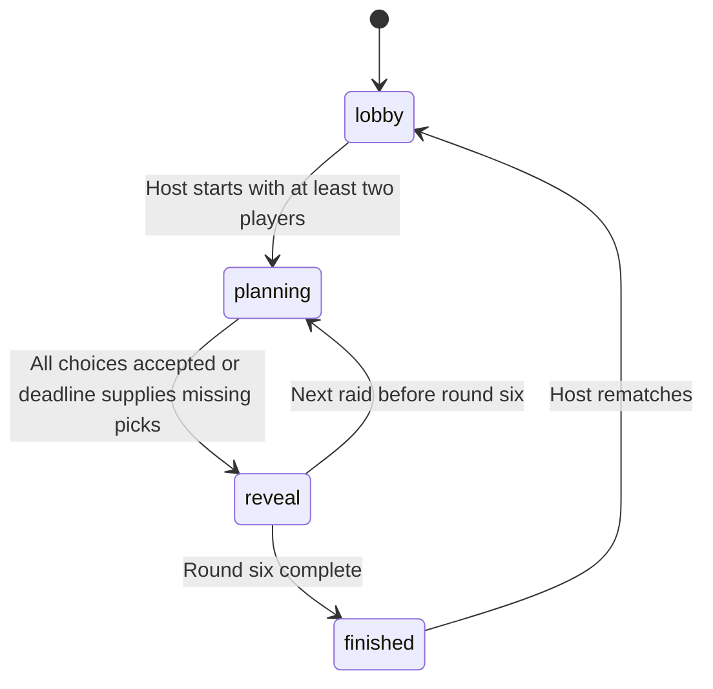

# Architecture and decisions

Raincheck Raccoons is a server-authoritative simultaneous-turn game. React runs in the browser, a Vinext-built Worker handles HTTP, and Cloudflare D1 persists rooms. Node.js is development tooling, not the hosted request runtime.

## Boundaries

| Boundary | Owner |
|---|---|
| Display and uncommitted selections | `app/page.tsx` |
| Legal actions, scores, bots and phases | `lib/engine.ts` |
| Session identity and request validation | `lib/server.ts` |
| Durable state and concurrency | `lib/store.ts` |
| Public DTOs/action contracts | `lib/types.ts` |

`components/Art.tsx` and `lib/audio.ts` provide presentation. `components/ui/`, connector support and build helpers are retained starter infrastructure; the delivered game does not depend on a connected external app or an LLM API at runtime.

## State machine

The engine receives an injectable clock and random generator, enabling deterministic tests. Server-side requests evaluate expired deadlines and host inactivity; there is no permanently running per-room timer or background scheduler. A room with no requests does not run continuously. A returning request advances eligible state.

## API

| Method/path | Purpose |
|---|---|
| `POST /api/rooms` | Create a room or practice match; establish session cookie |
| `POST /api/rooms/:code/join` | Join/recover a seat |
| `GET /api/rooms/:code` | Poll an authenticated, player-specific view |
| `POST /api/rooms/:code/actions` | Choose, start, advance, rematch, add/remove a participant, react or leave |

Actions use a strict Zod discriminated union. A choice includes `matchId` and `round`, preventing cross-round and cross-rematch replay. Identical locked choices are idempotent; edits are rejected. Responses include a revision and server time. Opponents' choices remain absent during planning rather than being hidden only by CSS.

## Persistence and optimistic concurrency

Two tables are defined in `db/schema.ts` and generated into `drizzle/`:

- `rooms`: code primary key, revision, serialized room state and expiry; indexed by expiry.
- `rate_limits`: quota key, counter and expiry; indexed by expiry.

The bounded snapshot includes players, current choices, six-round history and deadlines. The application uses D1 prepared SQL directly; Drizzle provides typed schema and migration generation.

An update reads the room, applies an operation, then executes a conditional update requiring the original version and unexpired room. If another writer wins, the operation reloads and retries with jitter, up to twelve attempts. Failed contention returns a recoverable error. This avoids lost simultaneous joins/choices without claiming unlimited throughput or a distributed transaction across rooms.

## Why polling

Discrete simultaneous turns tolerate ordinary network delay. Polling avoids a persistent socket service and keeps state recovery to a current snapshot request. The next request is scheduled after 900ms during play, 1400ms in the lobby, or 4000ms while hidden; network time is additional. These are design settings, not measured latency guarantees.

The client rejects lower revisions and uses a lifecycle generation to invalidate pending responses after leaving. It retains draft choices during polling, offsets countdowns using server time, and preserves saved seats during transient startup errors. HttpOnly cookies carry identity; local storage contains only nickname, avatar, sound preference and room locator.

## Sessions and abuse controls

Sessions use 32 cryptographically random bytes, SHA-256 hashes in room state, and HttpOnly/SameSite cookies with Secure over HTTPS. Room codes locate invitations, not identities. Membership and host permissions are enforced server-side.

Requests are JSON-only, bounded to 4096 bytes, validated, checked for cross-origin mutation, and use bound SQL parameters. Private responses use no-store and Vary Cookie. Membership is checked before allocating per-session quota rows, and again inside mutation. Expired rooms and quotas are cleaned opportunistically. This is a scoped set of controls, not a penetration-test certification.

## Important tradeoffs

- A small JSON aggregate simplifies atomic room updates but is not a global analytics/event-sourcing architecture.
- Automatic conservative picks prevent indefinite stalls; the UI discloses them.
- Lookout cover applies once and needs a collector, preventing stacked protection or all-lookout reward farming.
- Rule-based bots never inspect hidden human choices and use the same scoring engine.
- Original SVG and synthesized audio provide a coherent visual identity without runtime media services.

[Back to README](../README.md)
